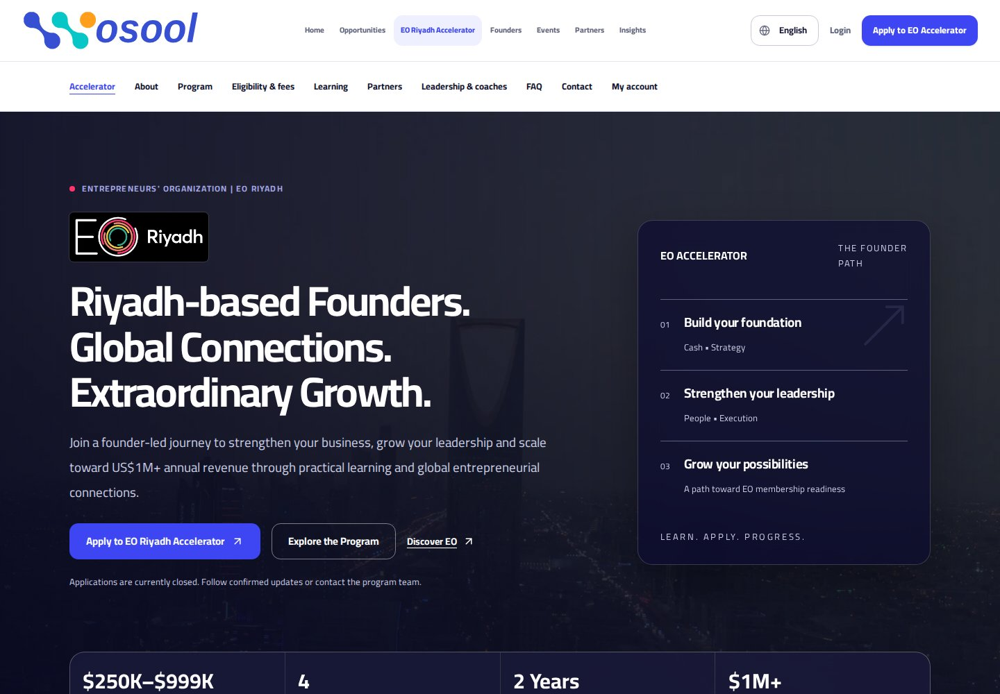
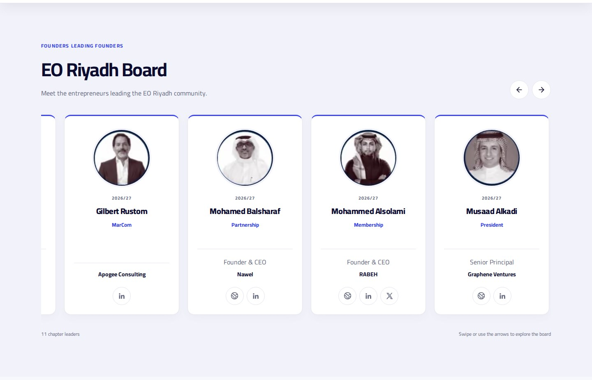

<p align="center">
  
</p>

<h1 align="center">Wosool | وصول</h1>

<p align="center"><strong>Founders to Founders — a Saudi-first community connecting founders across the WORLD.</strong></p>

<p align="center">
  <a href="https://github.com/king4arabs/wosool/actions/workflows/ci.yml"></a>
  <a href="LICENSE"></a>
  <a href="package.json"></a>
  <a href="backend/composer.json"></a>
</p>

<p align="center">
  <a href="https://wosool.org">Community website</a> ·
  <a href="https://wosool.org/eoa">EO Riyadh Accelerator</a> ·
  <a href="#quick-start">Quick start</a> ·
  <a href="#documentation">Documentation</a> ·
  <a href="https://github.com/king4arabs/wosool/issues">Report a bug</a>
</p>

Wosool brings founder profiles, startup and venture discovery, events, learning, reviewed introductions, collaboration, and administration into one Arabic/English platform. This monorepo contains the Next.js frontend, Laravel API, database migrations, tests, operating tools, and production documentation.

Wosool also provides the dedicated digital gateway for **EO Riyadh Accelerator** at **`/eoa`**: **Riyadh-based Founders. Global Connections. Extraordinary Growth.** Wosool community membership, Accelerator admission, official enrollment, graduation, and EO membership remain separate decisions and workflows.

> **Release boundary:** GitHub CI validates source, security checks, tests, and production builds. A commit, merge, or green workflow does **not** by itself prove that production hosting has deployed the change.

## Current platform snapshot — October 11, 2026

The latest product and brand upgrade includes:

- **Approved Wosool identity:** the connected-node W mark, large horizontal website wordmark, white footer version, and standalone favicon/application icon.
- **Unified product design system:** semantic tokens, Cairo as the primary Arabic and English typeface, responsive spacing, consistent cards, accessible controls, visible focus states, and reduced-motion behavior.
- **Trusted founder and venture scorecards:** company logo, founder portrait, role, short company/founder summaries, sector, stage, location, official links, verification, review freshness, source evidence, and opportunity signals where data is available.
- **World-class directory browsing:** equal-height responsive cards, controlled two-row browsing, pagination, search, RTL/LTR-aware controls, and no forced autoplay.
- **Reviewed founder introductions:** authenticated members can discover approved founders, state the purpose and intended value of a connection, submit through the established introduction API, and track the request.
- **Administration command center:** API-backed operational metrics and grouped navigation for community, operations, growth/content, EO Riyadh Accelerator, privacy, and system settings.
- **EO Riyadh Accelerator:** licensed Riyadh skyline video with a static reduced-motion poster, official EO palette, supplied EO Riyadh logo, nine-stage growth journey, and verified program information.
- **2026/27 EO Riyadh board:** 11 original poster portraits with researched company/profile links, accessible rightward carousel, and API-backed ordering, terms, publishing and secure portrait management.
- **Editorial operations:** bilingual operator content and FAQs with draft/published snapshots, stale-save protection, partner details, and audit history.
- **Reliability guardrails:** no fictional metrics, partners, founders, revenue, or affiliations; private contact and financial records remain protected; official EO and EO Riyadh artwork remains separate from Wosool artwork.

See [CHANGELOG.md](CHANGELOG.md) for release history and verified implementation details.

## EO Riyadh Accelerator preview

Local production-build screenshots with the seeded Laravel API (not a claim of live deployment):





[Arabic desktop](docs/screenshots/eoa-ar-desktop.jpg) · [Arabic mobile](docs/screenshots/eoa-ar-mobile.jpg) · [English mobile](docs/screenshots/eoa-en-mobile.jpg)

## Platform capabilities

- **Founder community:** public and authenticated profiles, company management, directories, reviewed introductions, chat, events, learning, and collaboration.
- **Startup, scaleup, and venture discovery:** Saudi-first ecosystem records, source provenance, editorial review, business classifications, official links, and scheduled freshness checks.
- **EO Riyadh Accelerator:** public discovery, eligibility, verified accounts, private server-saved applications, evidence, assigned review, interviews, decisions, onboarding, cohorts, participant services, coaching, and progress.
- **Administration:** scoped roles, application pipelines, founders, companies, scorecards, introductions, events, programs, partners, sponsors, news, analytics, privacy requests, settings, and EOA operations.
- **Bilingual experience:** Arabic/English, RTL/LTR, Cairo typography, logical spacing, responsive layouts, and accessible navigation.
- **Content reliability:** public partner, mentor, founder, revenue, and ecosystem claims require approved records and source evidence.

| Experience | Canonical route | Purpose |
| --- | --- | --- |
| Wosool community | `/` | Founder-community discovery and its own membership journey |
| Founder directory | `/founders` | Public approved founders and their companies |
| Startup directory | `/startups` | Sourced startup, scaleup, and venture discovery |
| Member workspace | `/dashboard` | Profiles, companies, community, matches, events, programs, and messages |
| EO Riyadh Accelerator | `/eoa` | Program discovery, eligibility, accounts, applications, and public content |
| Accelerator workspace | `/dashboard/eoa` | Applicant decisions, tracks, and participant services |
| Administration | `/admin` | Community and platform operations |
| EOA operations | `/eoa/admin` | Scoped Accelerator review and operations |
| Ecosystem directory | `/opportunities` | Sourced ecosystem entities and opportunities, not implied partnerships |

Legacy `/EOA` and `/accelerator` links are redirected to the canonical lowercase `/eoa` experience. The physical Next.js route tree is `frontend/src/app/eoa`.

## Architecture

| Component | Implementation |
| --- | --- |
| Frontend | Next.js 16.4, React 19, strict TypeScript, Tailwind CSS 4, Cairo Variable, Arabic/English RTL/LTR |
| Backend | Laravel 13, PHP 8.3+, Sanctum cookie sessions, Spatie roles and permissions |
| Database | SQLite for local development/tests; verify and preserve the configured production database engine |
| API | Same-origin browser access through `/api/v1`, server-side authorization, validation, CSRF protection, rate limits, and resources |
| EOA routes | `frontend/src/app/eoa`, `frontend/src/components/eoa`, `backend/routes/eoa.php` |
| EOA domain | `backend/app/Services/Eoa`, `backend/app/Http/Controllers/Api/Eoa` |
| Ecosystem records | `/opportunities`, `ecosystem_records`, and the source ledger under `docs/research` |
| CI | Frontend lint, types, tests, data validation, dependency audit, build; backend syntax, tests, audits, and build |
| Deployment | Separate Node and PHP applications; repository CI validates but does not deploy production |

Browser API requests use the same-origin proxy. Sessions use CSRF protection. Sensitive application fields are encrypted and versioned server-side; supporting documents remain private and authorization-controlled. Do not expose backend storage or rotate the application encryption key without a tested recovery plan.

```text
.
├── frontend/       # Next.js app, design system, public/member/admin UI, API clients, frontend tests
├── backend/        # Laravel API, domain services, models, migrations, policies, jobs, backend tests
├── docs/           # Product, API, EOA, research, operations, and release documentation
├── scripts/        # Setup, development, validation, import, and operational commands
└── package.json    # Monorepo setup, verification, and build entry points
```

## Quick start

### Prerequisites

- Node.js **22.12+ on 22.x, or 24.x**, with npm.
- PHP **8.3+** and Composer **2**, compatible with the committed lockfile.
- Required PHP extensions; CI enables `mbstring`, `dom`, `curl`, `pdo_sqlite`, and `sqlite3`.
- Git and a Bash-compatible shell for the combined development launcher.

### Install and run locally

```bash
git clone https://github.com/king4arabs/wosool.git
cd wosool
npm run setup

# Optional: make the documented frontend defaults explicit.
test -f frontend/.env.local || cp frontend/.env.example frontend/.env.local

npm run dev
```

`npm run setup` installs locked frontend/backend dependencies, prepares a missing backend environment and key, creates the local SQLite file when required, runs migrations, and runs the non-destructive `eoa:install` setup. It preserves existing configuration, refuses production demonstration setup, and does not seed privileged accounts.

| Service | Local address |
| --- | --- |
| Frontend | http://localhost:3000 |
| API liveness | http://localhost:8000/api/health |
| API readiness | http://localhost:8000/api/ready |

Run a queue worker in a second terminal:

```bash
php backend/artisan queue:work --tries=5 --timeout=60
```

> Local mail defaults to `MAIL_MAILER=log` and does not deliver email. Use a controlled mail sink for verification and recovery tests. Keep EOA data collection and intake closed until the required administrative and privacy approvals are configured.

### Optional data imports

```bash
# Preview and apply the wider ecosystem import.
php backend/artisan wosool:import-ecosystem
php backend/artisan wosool:import-ecosystem --apply

# Preview and import the sourced startup/founder directory.
php backend/artisan directory:import --dry-run
php backend/artisan directory:import
```

Production imports require a verified staging run, backups, source review, and publication approval. Never run fictional demonstration seeders in production.

## Development commands

Run commands from the repository root after setup:

| Command | Purpose |
| --- | --- |
| `npm run dev` | Start frontend and backend together; stop both with Ctrl+C |
| `npm run dev:frontend` / `npm run dev:backend` | Start one application independently |
| `npm run lint` | Run frontend ESLint |
| `npm run type-check` | Check frontend TypeScript |
| `npm run test` | Run frontend and backend regression suites |
| `npm run test:frontend` / `npm run test:backend` | Run one test suite |
| `npm run validate:entrepreneurs` | Validate the researched entrepreneur dataset |
| `npm run build` | Build both applications |
| `npm run verify` | Run lint, types, tests, data validation, and both builds |
| `npm run eoa:install` | Repeat the non-destructive EOA installer |

Reverb is optional and is not started by default. Configure it before using `RUN_REVERB=1 npm run dev`.

<details>
<summary>Common local issues</summary>

- **SQLite file cannot be created:** verify `DB_DATABASE` and parent-directory permissions.
- **API requests fail:** ensure the backend is running and `NEXT_PUBLIC_API_URL` points to its origin without `/api`; restart the frontend after environment changes.
- **Verification or reset email does not arrive:** the default log mailer is not a sending transport; configure a controlled mail sink and run the queue worker.
- **EOA registration or submission is unavailable:** check privacy notice, intake, and program settings in [EOA operations](docs/EOA.md); do not bypass the gates.
- **Ports are occupied:** stop conflicting processes or start frontend/backend independently with appropriate ports.

</details>

## Configuration

Use [`frontend/.env.example`](frontend/.env.example) and [`backend/.env.example`](backend/.env.example) as references. Frontend overrides belong in `frontend/.env.local`; backend values belong in `backend/.env`. `NEXT_PUBLIC_*` values are public browser configuration and must never contain secrets.

| Variable | Purpose |
| --- | --- |
| `NEXT_PUBLIC_SITE_URL` | Canonical frontend origin; production `https://wosool.org` |
| `NEXT_PUBLIC_API_URL` | Actual backend origin without `/api`; rebuild frontend after changes |
| `NEXT_PUBLIC_EOA_HERO_VIDEO_WEBM` | Optional approved WebM hero footage for `/eoa` |
| `NEXT_PUBLIC_EOA_HERO_VIDEO_MP4` | Optional approved MP4 hero footage for `/eoa` |
| `NEXT_PUBLIC_EOA_HERO_POSTER` | Optional approved poster/fallback image for `/eoa` |
| `APP_ENV`, `APP_DEBUG` | Production environment and `false` debug setting |
| `APP_KEY` | Stable protected encryption key retained with recovery materials |
| `APP_URL`, `FRONTEND_URL` | Backend/frontend origins, including verification and recovery links |
| `SANCTUM_STATEFUL_DOMAINS`, `SESSION_DOMAIN` | Correct origins and cookie scope for the deployed topology |
| `SESSION_SECURE_COOKIE`, `SESSION_ENCRYPT` | Must be enabled in production |
| `DB_*`, `CACHE_STORE`, `QUEUE_CONNECTION` | Durable database, shared cache, and supervised queue configuration |
| `MAIL_*` | Real delivery transport, verified sender, and delivery testing |
| `NEXT_PUBLIC_ENABLE_DEMO_CONTENT` | Development fixtures only; ignored in production |
| `REVERB_*` | Optional realtime community integration |

Never commit secrets, private applicant documents, tokens, or backups. Rebuild Laravel configuration caches after environment changes. Legacy gateway flags do not authorize EOA collection or intake; approvals belong to EOA administrative settings.

## Roles and workflows

- `eoa_applicant`: own verified account, draft application, evidence, decisions, and notifications.
- Participants: enrollment-derived access to their own checklist, calendar, registrations, resources, accountability group/coach, goals, attendance, feedback, and announcements.
- `eoa_reviewer`: assigned applications only; no final decisions or financial approval.
- `eoa_coach`: assigned participant development and attendance; no application-finance access.
- `eoa_staff`: review coordination and program operations.
- `eoa_lead` and existing platform administrators: approved local settings, final admission decisions, partner confirmations, and official/financial enrollment checks.
- Community member roles remain separate from Accelerator admission and EOA permissions.

Provision privileged users through the audited procedure in [EOA operations](docs/EOA.md). No privileged account is seeded. Applicants can submit data-rights requests through their EOA account; authorized administrators manage requests under `/admin/privacy-requests` according to retention and legal requirements.

## Content, directory, and partnership trust

- Public records must identify their source, last review date, publication state, and relationship status where applicable.
- A logo, event listing, research record, or ecosystem mention does not establish a partnership.
- Founder photos, logos, websites, roles, revenue evidence, and social links must come from approved or publicly verifiable sources.
- Private founder contact information, application finances, applicant documents, and confidential peer discussions never belong in public responses or frontend bundles.
- Automated ranking may support discovery; human reviewers retain publication, relationship, and admission decisions.
- Meeting minimum EOA eligibility does not guarantee admission, program completion does not guarantee growth, and graduation does not grant automatic EO membership.

[EOA research](docs/EOA-RESEARCH.md) records official program facts separately from proposed Riyadh delivery decisions. Local dates, fees, sponsorship allocations, partner claims, privacy notices, and commercial terms remain draft until formally approved.

## Brand system

The shared design tokens live in [`frontend/src/app/brand.css`](frontend/src/app/brand.css), consumed by global CSS, Tailwind utilities, public pages, member workspaces, administration, and EOA components.

### Wosool identity assets

| Asset | Use |
| --- | --- |
| [`frontend/public/wosool-logo-eo.svg`](frontend/public/wosool-logo-eo.svg) | Primary connected-node horizontal website logo |
| [`frontend/public/wosool-logo-white.svg`](frontend/public/wosool-logo-white.svg) | White footer/dark-background logo |
| [`frontend/public/wosool-w-favicon.svg`](frontend/public/wosool-w-favicon.svg) | Favicon and compact application icon |
| [`frontend/public/wosool-network-logo.png`](frontend/public/wosool-network-logo.png) | Legacy raster compatibility and selected touch-image use |

The approved Wosool mark follows the connected-node geometry supplied by the project owner and uses the Wosool/EO-inspired palette. It is the Wosool parent-platform identity, not a replacement or recreation of official EO or EO Riyadh logos.

### Interface principles

- Base navy `#0C0C31`, white `#FFFFFF`, action blue `#3D46F2`.
- Supporting pink `#FF346E`, orange `#FA653C`, yellow `#EFB82E`, green `#1EA691`, and gray `#5E617D`.
- Use semantic tokens instead of new literal palettes.
- Cairo Variable is the primary product typeface for Arabic and English.
- Use responsive `clamp()` sizing, logical spacing, normal Arabic letter spacing, visible focus states, and controls at least 44px tall.
- Honor `prefers-reduced-motion` and never make animation the only way to access content.
- Preserve official EO/EO Riyadh artwork, aspect ratios, clear space, provenance, and approval rules documented in [the partner asset register](docs/research/PARTNER-ASSETS.md).

## Verification and release

```bash
npm run verify
cd backend
php artisan wosool:check-readiness

# Only on a configured release after required approvals:
php artisan wosool:check-readiness --production
```

CI currently covers:

- Frontend dependency installation, ESLint, TypeScript, automated tests, entrepreneur-data validation, production dependency audit, and Next.js production build.
- Backend Composer installation, application/migration PHP syntax, Composer audit, Laravel tests, Node dependency audit, and backend asset build.

`/api/health` is liveness. `/api/ready` checks database access, applied migrations, and required EOA schema/program records. Neither endpoint proves delivered email, supervised workers, backups, browser acceptance, privacy compliance, or production deployment.

Follow [DEPLOYMENT.md](DEPLOYMENT.md) and [EOA operations](docs/EOA.md) for deployment, backups, restore rehearsal, migrations, queues, mail, rollback, and smoke tests. Keep EOA intake closed until approvals and live checks pass.

Remaining external dependencies include configured hosting/deployment access, production database validation, persistent private storage, real email, supervised workers, approved partner/program decisions, deployed browser acceptance, and backup recovery tests. No payment gateway, EO enrollment API, or production deployment is simulated.

## Documentation

| Guide | Contents |
| --- | --- |
| [Architecture](ARCHITECTURE.md) | System structure and engineering context |
| [API reference](docs/API.md) | Backend interfaces |
| [Community homepage](docs/COMMUNITY-HOMEPAGE.md) | Main Wosool community experience |
| [EOA operations](docs/EOA.md) | Authoritative Accelerator workflows, access, and approvals |
| [Startup directory](docs/STARTUP-DIRECTORY.md) | Sourcing, imports, review, and publication controls |
| [Testing](TESTING.md) | Automated coverage and manual acceptance gates |
| [Deployment](DEPLOYMENT.md) | Hosting, release, backup, and rollback procedures |
| [Security policy](SECURITY.md) | Private reporting and operating controls |
| [EOA research](docs/EOA-RESEARCH.md) | Official program facts and source notes |
| [EOA board release](docs/EOA-BOARD-RELEASE-2026-10-11.md) | Board management, editorial workflow, local checks and deployment status |
| [Board research](docs/research/EO-RIYADH-BOARD-2026-27.md) | Portrait mapping, professional sources and unresolved entries |
| [EOA media and sources](docs/research/EOA-SOURCES-2026-10-11.md) | Skyline license, original logos and current official program facts |
| [Partner assets](docs/research/PARTNER-ASSETS.md) | Artwork provenance and approval constraints |
| [Reliability release notes](docs/WOSOOL-RELIABILITY-EOA-2026-10-09.md) | October 9 reliability, tracks, and role changes |
| [Integration release notes](docs/EOA-INTEGRATION-2026-10-09.md) | Canonical EOA migration and legacy compatibility |
| [Changelog](CHANGELOG.md) | Release history and current implementation changes |
| [Roadmap](ROADMAP.md) | Planned direction |

## Contributing

1. Start from the latest `main` and preserve unrelated concurrent work.
2. Keep changes focused; preserve records, authorization boundaries, approval gates, and bilingual behavior.
3. Add regression coverage for behavior changes and review Arabic/English, RTL/LTR, mobile, keyboard, reduced-motion, and error states.
4. Update README, CHANGELOG, configuration examples, and affected guides in the same changeset when architecture, routes, dependencies, security, testing, deployment, or product behavior changes.
5. Run `npm run verify` and relevant readiness/security checks before requesting merge.
6. Document manual checks, external dependencies, and limitations; never represent CI as production deployment.

## Security

Report vulnerabilities privately through [SECURITY.md](SECURITY.md), not public issues. Never commit credentials, tokens, private applicant documents, confidential financial records, or backups. Keep production debug disabled, protect private storage, apply least privilege, and retain the application encryption key with tested recovery materials.

## License

The software repository is licensed under the [MIT License](LICENSE). Third-party artwork and trademarks remain subject to their owners' rights and approval requirements; the software license does not grant partnership, endorsement, or trademark rights.
